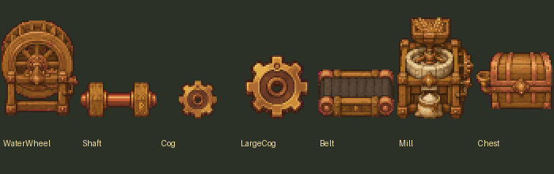
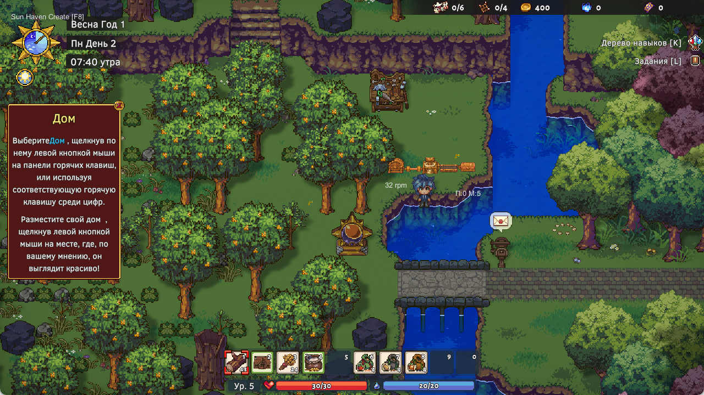

<div align="center">

# Sun Haven Create

### Солнечная механика · Solar Workshop

Механическая автоматизация для уютного фэнтезийного мира Sun Haven


[](https://github.com/IgorKramar/sun-haven-create/actions/workflows/checks.yml)
[](LICENSE)

[Скачать альфу](https://github.com/IgorKramar/sun-haven-create/releases/tag/v0.3.0-alpha) · [Русский](#что-добавлено) · [English](#english) · [План](ROADMAP.md) · [Проверки](docs/VERIFICATION.md) · [Изменения](CHANGELOG.md)

</div>



**Играбельная альфа 0.3.0.** Последняя проверка в настоящей игре — 14 октября 2026 года; подготовка репозитория и повторный прогон 17 проверок ядра — 31 октября. Это первая производственная цепочка, а не полный перенос Create.

Механическая производственная цепочка для одиночного Sun Haven: источник вращения → вал/шестерни → мельница → конвейер → сундук. Это самостоятельная адаптация идей Create к Sun Haven. Полный набор Create ещё не реализован.

## Что добавлено

- Семь механизмов: водяное колесо, вал, малая и большая шестерни, конвейер, мельница и выходной сундук.
- Передача вращения между соседними механизмами, отношение шестерней 2:1, направление вращения, перегрузка и конфликт источников.
- Переработка настоящей пшеницы в настоящую муку и доставка по конвейеру.
- Строительство за настоящие брёвна. Разборка возвращает затраты; сначала нужно забрать содержимое.
- Постройки, буферы и незавершённая переработка сохраняются вместе с миром.
- Проверка свободной земли и занятости клетки. Колесо, мельница и сундук имеют коллизии; валы и конвейеры проходимы.
- Русская панель строительства.
- Первый комплект спрайтов fal.ai: дерево, медь, латунь и янтарные руны.
- Записка солнечной мастерской в обычном диалоге игры: F8 → «Прочесть записку мастера».

## Как играть

После установки запускайте **Sun Haven через Steam**, входите в одиночный мир и нажимайте **F8**.

1. Выберите механизм в панели. Цена указана в брёвнах.
2. Наведите курсор на свободную клетку рядом с персонажем и нажмите **P**. Механизмы соединяются по четырём направлениям.
3. **R** меняет направление выхода мельницы/конвейера до установки.
4. Наведите курсор на мельницу и нажмите **T**, чтобы вложить одну единицу пшеницы из инвентаря. Можно положить пшеницу в конвейер, направленный к мельнице.
5. Мельница выдаёт одну муку за 3 секунды при 32 rpm. Разместите конвейер и сундук в направлении выхода, чтобы собирать результат.
6. Наведите курсор на механизм и нажмите **G**, чтобы забрать один предмет. Мука выдаётся первой. При полном инвентаре содержимое остаётся в механизме.
7. **Delete** разбирает пустой механизм и возвращает брёвна. **F8** закрывает панель.

Пока панель открыта, обычное управление персонажем отключено: это предотвращает случайное применение инструмента или размещение обычной мебели при выборе механизма. Закройте панель для ходьбы. Радиус строительства — 12 клеток, предел — 128 механизмов на локацию; буфер — 64 предмета.

| Механизм | Брёвна |
|---|---:|
| Водяное колесо | 8 |
| Вал | 1 |
| Малая шестерня | 2 |
| Большая шестерня | 4 |
| Конвейер | 2 |
| Мельница | 6 |
| Выходной сундук | 4 |

## Проверка

Проверено на Sun Haven **v3.1.3b, Steam build 24721658**, Unity 2022.3.62f2, Windows, BepInEx 5.4.23.5 x64.

Сборка DLL: 0 ошибок и предупреждений. Ядро и формат сохранения: 17 автоматических проверок. В настоящем мире персонажа CreateLab проверены расход 21 бревна на цепочку, переработка трёх единиц пшеницы, получение муки в обычный инвентарь и сохранение/повторная загрузка пяти механизмов с тем же количеством ресурсов. Файлы остальных четырёх персонажей сверены с резервными копиями и не изменились.

Подробности, исходные снимки состояний и границы проверки — в [отчёте](docs/VERIFICATION.md).



## Текущие ограничения

Это ранняя версия. Рецепт пока только один; водяное колесо служит упрощённым источником энергии без требования воды. Всем соседним механизмам, кроме сундука, разрешена передача вращения; модель проще оригинального Create. Колесо выдаёт 32 rpm и мощность 1024, мельница потребляет 8 единиц на rpm, конвейер — 1. Несовместимые источники/перегрузка останавливают сеть.

Пока нет поездов, подвижных конструкций, жидкостей, пресса, смешивания, механической сборки, опыта за крафт и мультиплеерной синхронизации. Производство работает в текущей загруженной локации и останавливается на паузе/в кат-сцене. Первый комплект графики подключён; анимации колеса, мельницы и ленты ещё требуют доработки. Строительство доступно через панель мода, без новых предметов в каталоге игры.

Мод предназначен для одиночной игры; взаимодействие с другими модами пока не проверено. При крупном обновлении Sun Haven потребуется повторная проверка.

## Установка

1. Сделайте копию папки сохранений `%USERPROFILE%\AppData\LocalLow\Pixel Sprout Studios\Sun Haven`.
2. Установите [BepInEx 5.4.23.5 x64](https://github.com/BepInEx/BepInEx/releases/tag/v5.4.23.5) в папку игры.
3. Если у вас есть готовый установочный ZIP 0.3.0, скопируйте его папку `BepInEx` в папку игры. В `plugins/SunHavenCreate` нужны **обе DLL** (SunHavenCreate и Newtonsoft.Json) и каталог `assets`. Исходный ZIP GitHub не является установочным: для исходников выполните сборку ниже.
4. Запускайте игру через Steam. Для диагностики смотрите `BepInEx/LogOutput.log`.

Для удаления сначала заберите ресурсы и разберите механизмы. Затем уберите папку `BepInEx/plugins/SunHavenCreate`. Данные фабрики сохраняются в отдельном ключе прогресса мира, но без мода эти буферы недоступны. Повторная установка возвращает доступ к ним.

## Сборка из исходников

Нужны .NET SDK 10, установленная игра и BepInEx 5. Укажите свои пути. Для сборки и упаковки используйте:

```powershell
.\build.ps1 -GameManaged "C:\Games\Sun Haven\Sun Haven_Data\Managed" -LoaderCore "C:\Games\Sun Haven\BepInEx\core"
```

Результат: `artifacts/BepInEx/plugins/SunHavenCreate`. Скрипт включает собственные PNG и Newtonsoft.Json, но не DLL игры. Альтернативные команды:

```powershell
dotnet build .\src\SunHavenCreate.csproj -c Release '-p:GameManaged=C:\path\Sun Haven\Sun Haven_Data\Managed' '-p:LoaderCore=C:\path\BepInEx\core'
dotnet run --project .\tests\Kinetics.Checks.csproj -c Release
```

Проверки требуют .NET SDK 10. Библиотеки игры не включены; ссылки имеют `Private=false`. Newtonsoft.Json 13.0.3 включён по MIT, лицензия приложена.

В конфигурации `local.sunhavencreate.prototype.cfg` параметр `WorldIntegration=false` включает старый временный стенд без настоящего инвентаря/сохранений. `LocalTestBridge` по умолчанию выключен; команды разработчика, меняющие игровые ресурсы, разрешены только персонажу CreateLab в локальном мире.

## Авторы и источники

Код создан с помощью Codex (GPT-6). Арт сгенерирован через fal.ai: openai/gpt-image-2 и fal-ai/nano-banana-2/edit, затем очищен от фона и подогнан к прозрачным пиксельным кадрам. История генераций приложена в [assets/fal_manifest.jsonl](assets/fal_manifest.jsonl), происхождение и условия — в [ASSETS.md](ASSETS.md). Код, текстуры и прочие файлы Minecraft/Create не включены. Это не официальный проект Pixel Sprout Studios или Creators of Create.

Записка мастерской — авторский текст мода. Стилистическая опора: [официальный рассказ о лоре Sun Haven](https://www.pixelsproutstudios.com/post/sun-haven-dev-blog-03-lore), связывающий благословения драконов с водой и урожаем. «Солнечная механика» — новая история мода.

[Create](https://github.com/Creators-of-Create/Create), [BepInEx](https://github.com/BepInEx/BepInEx), [сообщество Sun Haven / Keep Alive](https://github.com/p1xel8ted/Sun-Haven-Mods), [Newtonsoft.Json](https://www.nuget.org/packages/Newtonsoft.Json/13.0.3). Исходный код — MIT, см. `LICENSE`.


## English

**Create-inspired mechanical automation for Sun Haven.** This is an early, playable single-player alpha with a seven-machine set and one wheat-to-flour chain. It is an independent adaptation, not the full Java mod port.

- Water wheel, shaft, two gear sizes, conveyor, mill and output chest.
- Rotation, 2:1 gear ratios, stress overload and incompatible power sources.
- Real inventory costs, deposits, collection, construction refunds and world persistence.
- Original wood/copper/amber art generated through fal.ai and a native solar workshop dialogue.

Tested in **Sun Haven v3.1.3b / Steam build 24721658**, Windows, BepInEx **5.4.23.5 x64**, on **14 October 2026**. Later game versions are not verified. Seventeen kinetics/persistence checks passed again on **31 October 2026**.

**Install:** download the install ZIP from the [0.3.0-alpha release](https://github.com/IgorKramar/sun-haven-create/releases/tag/v0.3.0-alpha), back up saves, install BepInEx separately and copy the ZIP’s `BepInEx` folder into the game directory. Alternatively, build with `build.ps1` against your own game and loader. Start through Steam. GitHub's source archive is not a ready-to-install mod package.

**Controls:** F8 opens/closes the Russian construction panel; P builds at the cursor, R changes output direction, T inserts one wheat, G collects one item, Delete dismantles an empty machine. Close the panel to walk. The workshop note is also in Russian.

**Limits:** one recipe, simplified power network, wheel does not require flowing water, current-location production only, unfinished wheel/mill/belt animations, no trains, moving constructions, fluids or multiplayer. [Roadmap](ROADMAP.md), [verification](docs/VERIFICATION.md), [asset provenance](ASSETS.md), [contributing](CONTRIBUTING.md).
